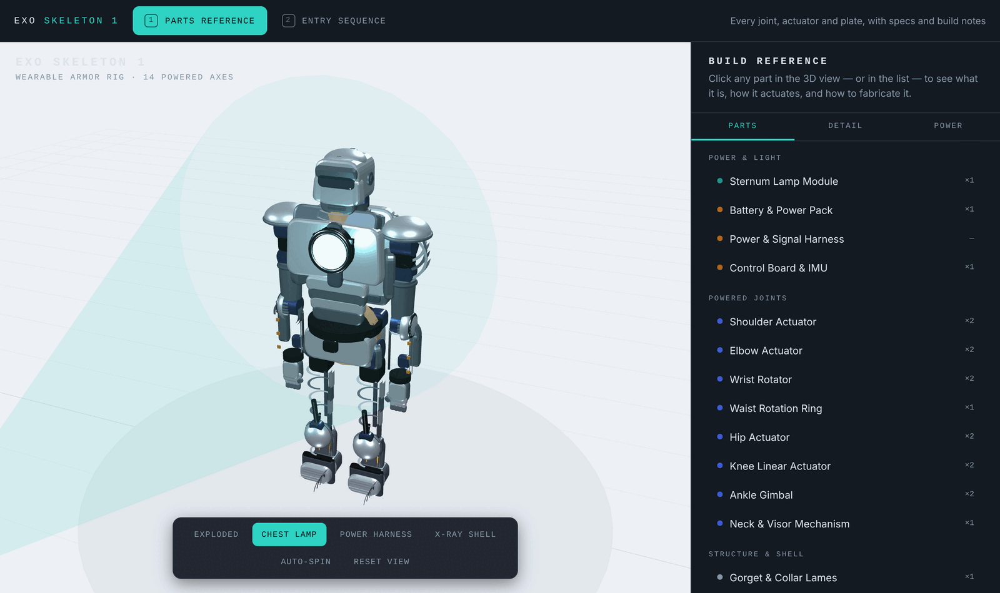
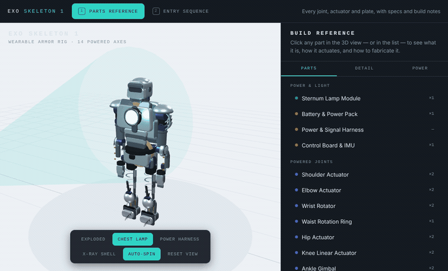
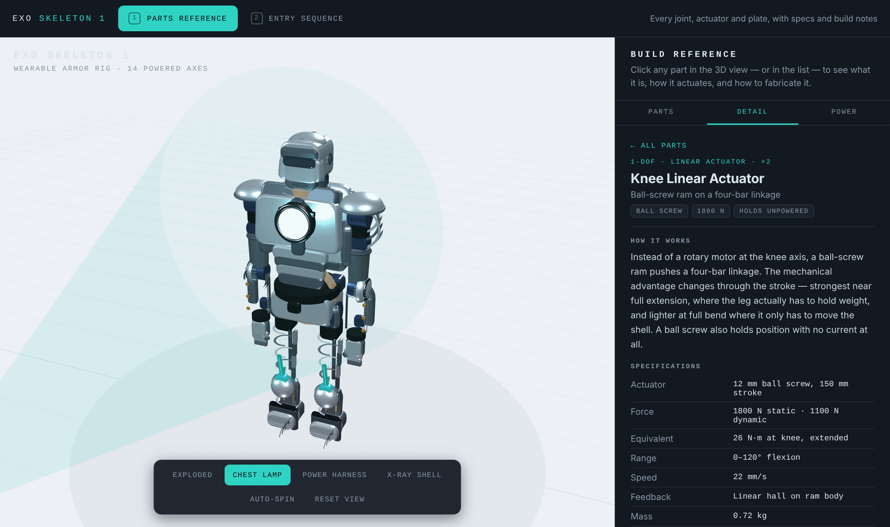
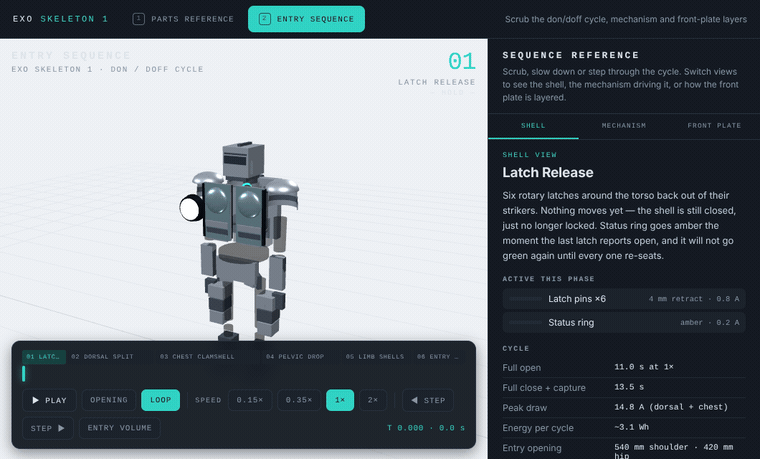
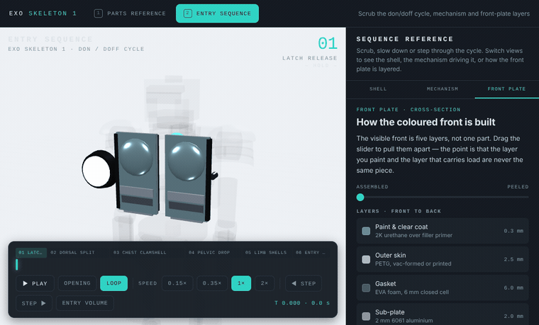

# Exo Skeleton 1

**[→ Open the live viewer](https://exo-skeleton1.netlify.app/#parts)**

An interactive 3D reference for a powered wearable armor rig — every joint actuator, plate and
power component, plus a scrubable animation of how the shell opens so someone can step into it.

Runs in a browser with no build step, no framework and no install. Open `index.html` and it works.



## What this is

A design study, built as a teaching tool. The frame has 14 powered axes, 31 articulated lames and a
documented power budget, and every part in the model carries its own specification: what actuator
drives it, how much torque it makes, what it draws, and the fabrication notes that matter when you
actually build the thing.

It exists because most exoskeleton and armor references are either pretty renders with no
engineering behind them, or engineering documents with no picture. This is both at once — click a
knee and you get the ball-screw linkage, its 1800 N static force, and the reason the limit switches
have to be wired in hardware rather than firmware.

**Two views, switched from the tabs at the top:**

| View | What it shows | Live |
|---|---|---|
| **Parts Reference** | The assembled rig. Click any part for specs, actuation and build notes. Toggle exploded view, X-ray shell, the power harness and the chest lamp. | [open](https://exo-skeleton1.netlify.app/#parts) |
| **Entry Sequence** | The don/doff cycle as a scrubable timeline, with a mechanism cutaway and a layer-by-layer breakdown of the front plate. | [open](https://exo-skeleton1.netlify.app/#sequence) |

The URL hash selects the view, so `#parts` and `#sequence` are directly linkable.

### Parts reference

Orbit the rig, strip the shell back, or pull the whole assembly apart. The toolbar toggles an
exploded view, an X-ray shell, the power harness routing and the chest lamp.



Click any part — in the 3D view or in the list — and the panel gives you what drives it, what it
costs in torque and current, and the fabrication notes that matter when you build it.



### Entry sequence

The shell opens in six interlocked phases — latch release, dorsal split, chest clamshell, pelvic
drop, limb shells, entry hold. Scrub it, slow it to 0.15×, step phase by phase, or run it backwards
to watch it close.



Switching to **Mechanism** drops the shell to 11% opacity so you can watch the rams, latches and
four-bar linkages that drive the cycle, with callout labels. The order is not arbitrary: the dorsal
plate is the structural keystone, and the chest halves physically cannot clear until it has
travelled aft.

### Front plate construction

The **Front Plate** view pulls the coloured front apart into its five layers. The point it is making
is that the layer you paint and the layer that carries load are never the same piece — hinges and
latch strikers bolt into 2 mm aluminium, never into the plastic skin.



## Running it

The viewer is deployed at **[exo-skeleton1.netlify.app](https://exo-skeleton1.netlify.app/)** — nothing
to install if you just want to look at it.

To run it locally, open `index.html` in any modern browser. That is the whole procedure.

If your browser blocks local files, serve the folder instead:

```bash
python3 -m http.server 8000
# then open http://localhost:8000
```

### Deploying your own copy

`index.html` is self-contained, so any static host works with no build configuration:

- **Netlify** — drag the folder onto the dashboard, or connect the repo and leave the build command
  empty with the publish directory set to the repository root. This is how the live site above is
  hosted.
- **GitHub Pages** — push the repo and point Pages at the repository root.

If you edit the viewers in `src/`, run `python3 tools/build.py` before deploying so `index.html`
picks up the changes.

An internet connection is needed on first load: three.js is pulled from a CDN rather than vendored,
so this repository contains no third-party source. To run fully offline, download
`three.min.js` (r128) and change the `<script src=...>` tag in each file in `src/` to point at your
local copy, then rebuild.

## Controls

| Action | Parts Reference | Entry Sequence |
|---|---|---|
| Orbit | drag | drag |
| Zoom | scroll | scroll |
| Pan | shift-drag or right-drag | shift-drag or right-drag |
| Inspect a part | click it, or pick from the list | — |
| Play / pause | — | `Space` |
| Nudge timeline | — | `←` `→` |
| Switch view | `1` / `2` | `1` / `2` |

## Repository layout

```
index.html              generated single-file viewer — both views, with the tab switcher
src/
  parts-reference.html  standalone parts viewer
  entry-sequence.html   standalone sequence viewer
tools/
  build.py              regenerates index.html from the two viewers
docs/                   screenshots and demo GIFs used by this README
LICENSE                 Apache License 2.0
NOTICE                  attribution notice
```

### Why the build step

The two viewers are complete HTML documents with their own CSS and their own global JavaScript
scope. Merging them into one document would mean renaming hundreds of colliding identifiers and
namespacing every CSS rule. Instead `tools/build.py` embeds each document verbatim and hands it to
an `<iframe srcdoc>`, so each view keeps its own document, globals and stylesheet, exactly as if it
were opened on its own.

Edit the files in `src/`, then:

```bash
python3 tools/build.py
```

The only subtlety is that each viewer's own `</script>` tags are escaped on the way into the
template block and restored at runtime — without that, the HTML parser would close the template
early.

## Technical notes

- **three.js r128**, loaded from cdnjs. No bundler, no package manager, no dependencies to install.
- **Vanilla JavaScript**, no framework. Custom orbit controls rather than `OrbitControls` so the
  classic (non-module) three.js build is enough.
- **Geometry is generated in code** — beveled plates via `ExtrudeGeometry`, curved lames via
  partial-arc cylinders, domes via hemisphere slices. There are no mesh assets to load.
- **Raycast picking** maps every mesh back to a part ID, so clicking any fragment of a multi-mesh
  assembly selects the whole assembly.
- Requires WebGL. Tested at desktop and phone widths; the layout stacks below 900 px.

## A word on the numbers

The torque figures, current draws and mass budget are internally consistent and sized from the
geometry, but this is a design study rather than a validated engineering document. If you are
building a powered wearable, treat the safety interlocks as the starting point and not the finish:

- A hard-wired e-stop cutting the pack rail. Software hangs; a cut rail does not.
- A visor that opens mechanically with zero power, and a pull-cable latch release reachable from
  inside the frame. If the pack dies at full close, the wearer gets out unaided.
- Helmet fans interlocked so they cannot be off while the visor is down.
- Closing is the dangerous direction: hold-to-run control only, never a one-press close on a
  mechanism that shuts around a person.

## Design provenance

The Exo Skeleton 1 is an original design. Its forms come from historical plate armour construction —
gorget lames, pauldrons, couters, tassets, poleyns, sabatons — combined with contemporary actuator
packaging. It is not based on, derived from or affiliated with any existing character, film,
franchise or commercial product.

## Contributing

Issues and pull requests are welcome. If you are adding a part, it needs an entry in the `DB` object
with specs and build notes — a mesh with no documentation behind it is not what this project is for.
Please keep contributions free of third-party assets, so the repository stays dependency-free and
cleanly licensed.

## License

Licensed under the Apache License, Version 2.0. See [LICENSE](LICENSE) and [NOTICE](NOTICE).

```
Copyright 2026 The Exo Skeleton 1 Authors

Licensed under the Apache License, Version 2.0 (the "License");
you may not use this file except in compliance with the License.
You may obtain a copy of the License at

    http://www.apache.org/licenses/LICENSE-2.0

Unless required by applicable law or agreed to in writing, software
distributed under the License is distributed on an "AS IS" BASIS,
WITHOUT WARRANTIES OR CONDITIONS OF ANY KIND, either express or implied.
See the License for the specific language governing permissions and
limitations under the License.
```

three.js is loaded at runtime under its own MIT License and is not redistributed here.
